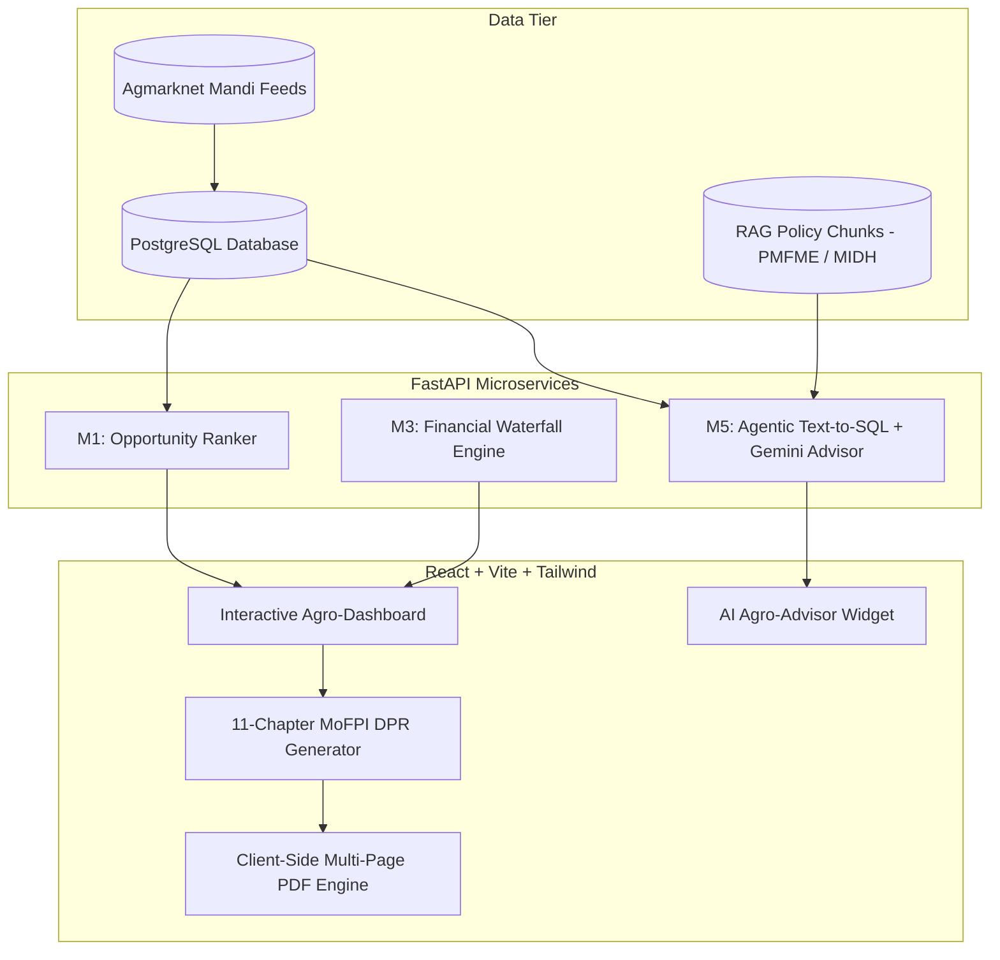

# PROJECT SYNOPSIS

## 1. Project Title
**EntreVision: Location-Aware AI Decision Support System and Automated DPR Synthesis for Citrus Agro-Enterprises in the Vidarbha Region**

---

## 2. Academic & Institutional Details
- **Degree:** Bachelor of Engineering (B.E.) in Information Technology
- **Institution:** Xavier Institute of Engineering, Mahim, Mumbai
- **Affiliated University:** University of Mumbai
- **Academic Year:** 2025 – 2026

---

## 3. Abstract
Post-harvest horticultural losses in the citrus belt of Vidarbha (Nagpur Mandarin) range between 25% to 35% annually due to lack of localized cold-chain access, seasonal market gluts, and absence of techno-economic guidance for rural micro-enterprises. While central and state schemes like the Pradhan Mantri Formalisation of Micro food processing Enterprises (PMFME) and MIDH provide up to 35%–50% capital subsidies, rural entrepreneurs struggle to formulate bank-compliant Detailed Project Reports (DPR), evaluate agro-climatic viability, and access predictive mandi intelligence. 

**EntreVision** is an end-to-end intelligent Decision Support System (DSS) tailored to the Vidarbha agro-industrial ecosystem. The platform ingests localized spatio-temporal datasets—including APMC mandi timeseries prices, tehsil-level groundwater and soil metrics, MSEDCL industrial electricity tariffs, and logistics freight corridors. Leveraging multi-criteria decision algorithms and Retrieval-Augmented Generation (RAG) with agentic SQL verification, EntreVision formulates customized agro-enterprise recommendations (e.g., cold extraction, candied peel valorization, solar packhouses). Furthermore, it dynamically synthesizes Ministry of Food Processing Industries (MoFPI) bank-grade DPRs with complete 5-year financial statements, Debt Service Coverage Ratios (DSCR), and client-side multi-page PDF generation.

---

## 4. Problem Statement & Motivation
1. **Severe Post-Harvest Glut & Distress Sales:** Farmers in Katol, Saoner, Narkhed, and Warud are frequently forced to sell Grade-B and Grade-C citrus at distress prices (₹4–₹8/kg) due to perishable harvest windows.
2. **Absence of Data-Driven Agro-Advisory:** Traditional extension services fail to correlate agro-processing venture feasibility with hyper-local utility tariffs, road distances to Kalamna/Katol APMCs, and water table availability.
3. **Credit Barrier & DPR Complexity:** Commercial banks require rigorous techno-economic feasibility reports containing 5-year cash flows, WDV depreciation, and DSCR metrics before sanctioning PMFME or CGTMSE collateral-free loans. Rural entrepreneurs lack the financial engineering tools to draft these documents.

---

## 5. Objectives of the Project
- **Objective 1:** Build a curated multi-source data repository combining historical APMC mandi rates, tehsil spatial bounds, MSEDCL electricity tariffs, and government scheme operational guidelines.
- **Objective 2:** Design a Decision Support System (DSS) using demographic, skill-based, and financial profiling to recommend viable agro-business archetypes.
- **Objective 3:** Implement an Agentic RAG Advisor capable of answering regulatory and scheme queries backed by live PostgreSQL database queries (Text-to-SQL).
- **Objective 4:** Develop an automated, bank-grade Detailed Project Report (DPR) synthesis engine complying with MoFPI and Indian Banks' Association (IBA) guidelines.
- **Objective 5:** Provide high-resolution, multi-page client-side PDF compilation (`html2pdf.js`) with dynamic financial modeling and regulatory compliance roadmaps.

---

## 6. System Architecture & Methodology

### Key Modules:
1. **Module 1 (M1) - Opportunity Ranking Engine:** Maps user capital, available land acreage, irrigation availability, and risk tolerance against agro-processing archetypes.
2. **Module 2 (M2) - Mandi Intelligence:** Processes historical arrivals and modal prices across Vidarbha APMCs.
3. **Module 3 (M3) - Financial Feasibility Engine:** Computes PMFME 35% credit-linked capital grants, promoter equity, WDV depreciation (15% machinery, 10% civil), debt amortization, and DSCR.
4. **Module 4 (M4) - Agentic Knowledge Assistant:** Hybrid pipeline combining LLM reasoning with deterministic PostgreSQL queries to eliminate hallucinations.
5. **Module 5 (M5) - Automated MoFPI DPR Synthesizer:** 11-chapter document compiler generating complete project reports ready for commercial bank submission.

---

## 7. Technology Stack
- **Frontend:** React.js (Vite), Tailwind CSS, Lucide React, `html2pdf.js`, Recharts
- **Backend:** Python 3.11, FastAPI, SQLAlchemy ORM, Pydantic v2, APScheduler
- **Database:** PostgreSQL (Relational schema with spatial distances, tariffs, and demographics)
- **AI & RAG:** Google Gemini API (`gemini-flash-latest`), Agentic Tool Calling, Sentence-Transformers
- **Version Control & Environment:** Git, GitHub, Python virtual environment, Node.js (v20+)

---

## 8. Expected Outcomes & Deliverables
1. A fully functioning web application tailored to the Vidarbha citrus agro-corridor.
2. Instantaneous generation of 11-chapter, MoFPI-compliant Detailed Project Reports (DPR).
3. Verifiable financial projections with calculated DSCR, IRR, and OpEx/CapEx breakdowns.
4. Verified AI agro-advisor with grounding in official government policies and live database records.

---

## 9. References
1. Ministry of Food Processing Industries (MoFPI), *Operational Guidelines for PMFME Scheme*, Govt of India.
2. Mission for Integrated Development of Horticulture (MIDH), *Cost Norms and Pattern of Assistance 2024–2025*.
3. ICAR - Central Citrus Research Institute (CCRI), Nagpur, *Citrus Cultivation & Post-Harvest Management Manual*.
4. Maharashtra State Agricultural Marketing Board (MSAMB), *Nagpur and Kalamna APMC Citrus Market Reports*.
